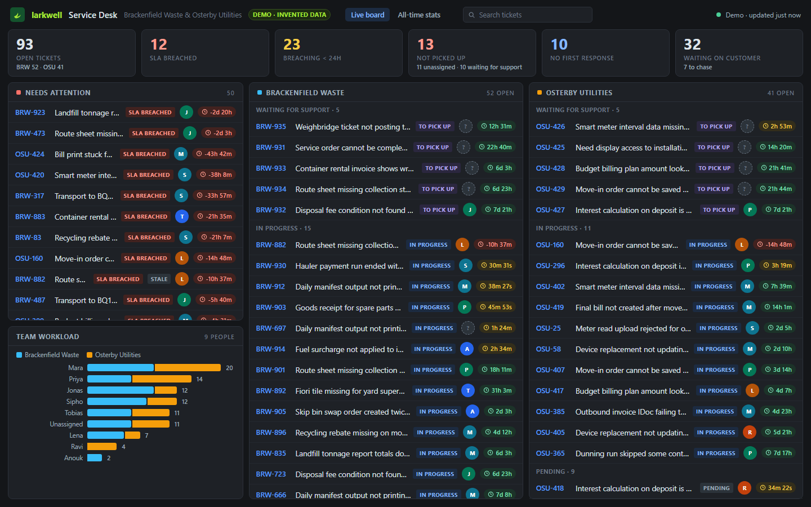
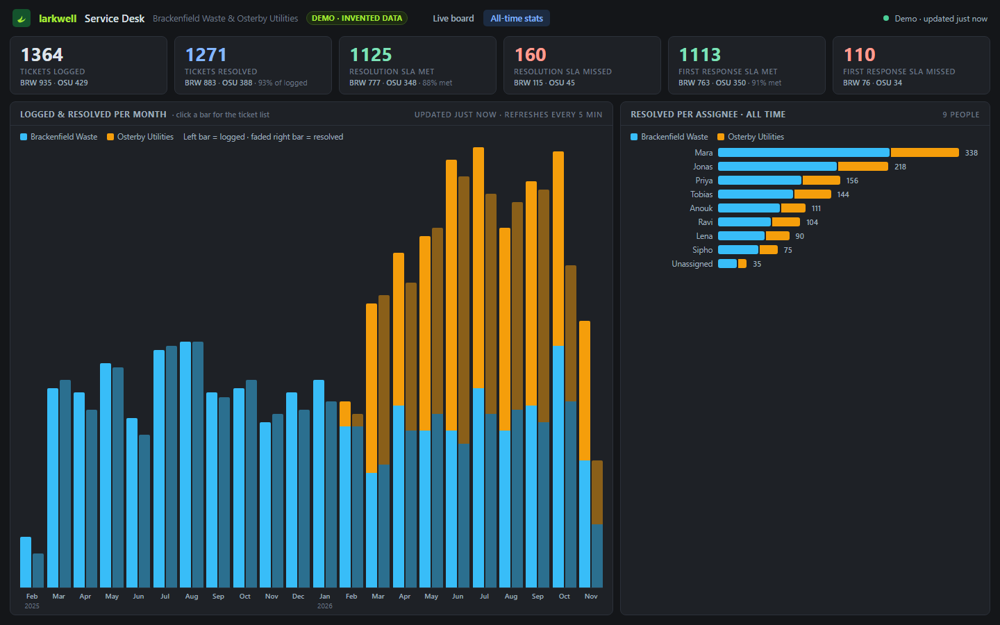
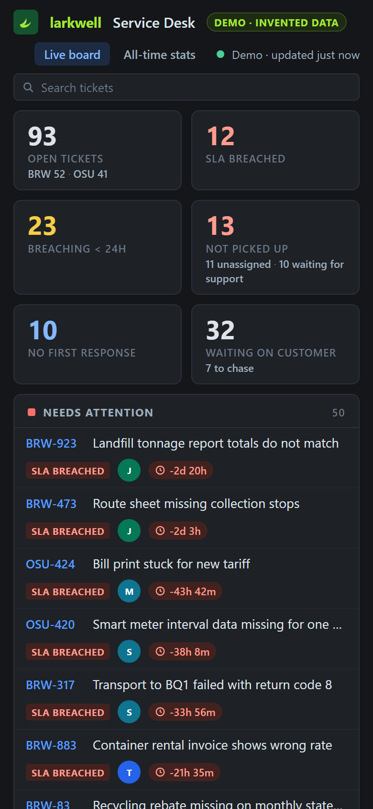
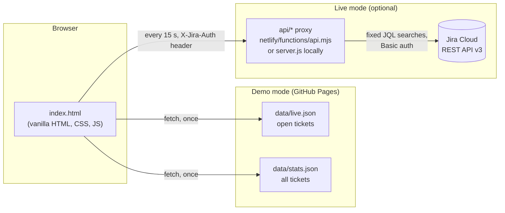

# Service desk wallboard

A dark, always-on wall display for a service delivery manager running a Jira
Service Management desk for two clients. One HTML file, no framework, no build
step.

> **Sanitised template.** This is a cleaned-up public version of a tool I built
> for my own work. Every company, client, person, ticket and number in it is
> invented: "Larkwell Consulting", "Brackenfield Waste" and "Osterby Utilities"
> do not exist, and the Jira site `larkwell-desk.example` is a placeholder. No
> real data, hosts or credentials are included.

**Live demo:** [tacitdev1.github.io/servicedesk-wallboard](https://tacitdev1.github.io/servicedesk-wallboard/)
· **Code:** [github.com/TacitDev1/servicedesk-wallboard](https://github.com/TacitDev1/servicedesk-wallboard)



## What it shows

**Live board** (refreshes every 15 seconds)

- **KPI tiles:** open tickets, SLA breached, breaching within 24 hours, not
  picked up, no first response, waiting on customer.
- **Needs attention:** every ticket with a reason to act, most urgent first:
  SLA breached, breaching soon, not picked up, unassigned, no first response,
  stale (no update for 5 days), chase the customer (waiting for 7 days).
- **Two client panels:** open tickets grouped by status, each with a live SLA
  countdown. Clocks under an hour count down by the second; paused clocks
  (waiting on customer) stay still.
- **Team workload:** open tickets per person, split by client.

**All-time stats**

- Tickets logged and resolved, and SLA met and missed for resolution and first
  response, per client.
- Logged and resolved per month, and resolved per person.

Every number and bar is clickable and opens the matching ticket list, sortable
by any column. In live mode, Ctrl-click opens the same list as a Jira search.

| All-time stats | Phone width |
|---|---|
|  |  |

## How it works



The page has two modes, chosen by `CONFIG.mode` at the top of `index.html`
or by adding `?mode=live` / `?mode=demo` to the URL.

### Demo mode (the default)

The page loads two bundled JSON files and never talks to Jira or any other
host. When it loads, it moves every timestamp forward so that the moment the
data was generated becomes "now". A ticket that was 20 minutes from breaching
in the file is 20 minutes from breaching whenever you open the page, so the
demo always looks current: some tickets breached, some about to breach, most
comfortable.

- `data/stats.json`: about 1,360 invented tickets over 21 months.
- `data/live.json`: the open tickets, generated from `stats.json` by
  `scripts/build-live-demo.mjs` (deterministic, so re-running it gives the same
  file).

Run it locally with any static file server. Opening `index.html` straight from
disk does not work, because browsers block `fetch` from `file://`.

```bash
node scripts/preview.mjs
```

That serves the site at `http://localhost:4399/servicedesk-wallboard/`, under
the same sub-path GitHub Pages uses, so a broken relative path shows up locally.

### Live mode: connect your own Jira

The proxy is a small stateless function with three fixed routes:

| Route | Answers |
|---|---|
| `GET api/me` | Is the sign-in good? |
| `GET api/live` | Every open ticket, reduced to the fields the board needs |
| `GET api/stats?project=KEY` | Every ticket ever, in chunks with a cursor |

It forwards each person's own Jira sign-in, stores nothing, logs nothing and
never echoes Jira's answers back. All settings come from environment variables:

1. Copy `.env.example` to `.env` and fill in your Jira site, your two project
   keys and the custom field IDs of the two SLA fields. `.env` is git-ignored.
2. Set the same two project keys, with display names and colours, in
   `CONFIG.clients` at the top of `index.html`.
3. Run it locally:

   ```bash
   node server.js
   ```

   Then open `http://localhost:8642/?mode=live`. If you set `JIRA_EMAIL` and
   `JIRA_API_TOKEN` in `.env`, the local server signs in for you. Otherwise the
   page asks for a Jira email and
   [API token](https://id.atlassian.com/manage-profile/security/api-tokens),
   which stay in that browser.
4. Or deploy to Netlify: `netlify.toml` stages the page and runs the function.
   Set the `JIRA_*` variables in the site's environment settings, but **not**
   `JIRA_EMAIL` or `JIRA_API_TOKEN`: on a public deploy each person signs in
   with their own token. Put a site password in front of it if your tickets are
   not public, and set `CONFIG.mode` to `'live'`.

## Repository layout

```
index.html                    the whole UI; CONFIG block at the top of the script
data/                         invented demo data
netlify/functions/api.mjs     optional Jira proxy (live mode)
server.js                     local server: page, data and the proxy
scripts/build-live-demo.mjs   regenerates data/live.json from data/stats.json
scripts/stage-site.mjs        copies the static site into _site/ for deploys
scripts/preview.mjs           serves _site/ under the Pages sub-path
scripts/leak-scan.mjs         fails if anything private slipped in
.github/workflows/            Pages deploy and leak scan
```

## Design notes

- **One file, no build.** A wall display should keep running for months
  without dependency updates. Everything is inline, so the strict content
  security policy in `netlify.toml` works.
- **Re-render in place.** Each refresh replaces panel contents without moving
  scroll positions or taking focus from the search box. Unchanged data does not
  re-render at all.
- **Match Jira's own definitions.** "SLA met" and "missed" use the same rules
  as Jira's `completed()` and `everBreached()` JQL functions, so a drill-down
  list and the Jira search behind it always agree.
- **No server-side secrets.** The proxy holds no token of its own. Each person
  uses their own Jira API token, kept only in their browser.

## Licence

MIT, see [LICENSE](LICENSE).
